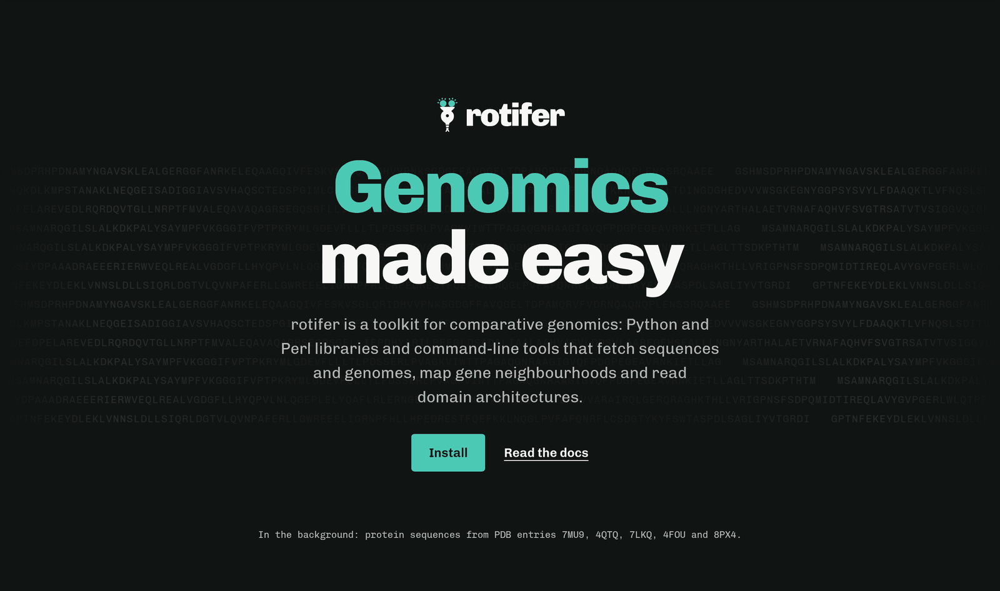

<a href="https://leepusp.github.io/rotifer/"></a>

# ROTIFER

Rapid Open-source Tools and Infrastructure For data Exploration and Research

ROTIFER is a toolkit for comparative genomics and the analysis of
biological sequences. It's a set of Python libraries for building
data analysis pipelines, plus command-line tools built on top of them.

## What it does

- Fetching biological data. `rotifer.db` gives NCBI, UniProt and local
  mirrors the same cursor interface. You can ask for one accession or
  thousands; the cursor batches the requests, retries failures and records
  what it could not find.
- Genomic context. Tools such as `acc2operon`, `neighborhood_explorer`,
  `operon2table` and `context2network` collect the genes around a protein
  and turn them into tables.
- Domains and alignments. `hmmer2table`, `hhsuite2table` and `blast2table`
  turn search output into tables. `domain2architecture` and
  `architecture2svg` build and draw domain architectures, and `alntool`
  cleans up alignments.

## Documentation

The documentation lives at <https://leepusp.github.io/rotifer/>. The
install steps below are also on its
[install page](https://leepusp.github.io/rotifer/install.html).

## Installation

ROTIFER isn't packaged for pip or conda yet. You run it from a copy of
the repository, inside a conda environment that holds its dependencies
and the bioinformatics programs it calls. Setting it up takes five
steps, and each command below can be copied with the button in the
corner of its block.

You need [conda](https://docs.conda.io/) (or mamba) and git. The
commands are written for a Unix shell such as bash or zsh.

### 1. Clone the repository

Download the source code and move into it:

## Installation

ROTIFER needs Python 3.11 or newer.

### Python library only

```Bash
pip install "rotifer[all]"
```

`rotifer[all]` installs every optional dependency. To keep the install small,
pick only the groups you need instead (e.g. `rotifer[seq,db]`):

| extra | for |
|-------|-----|
| `seq` | `rotifer.seq`, `rotifer.genome` |
| `db` | `rotifer.db`, `rotifer.alchemy` |
| `viz` | `rotifer.cluster` and plots |
| `network` | neighborhood graphs in `rotifer.genome` |
| `cli` | the Python tools in `bin/` |

pip also installs the commands ported from Perl (`hmmer2table`,
`blast2table`, `rrsw`, `domain2architecture`, ...). Some of them run
external programs, such as HMMER or Phobius, that you install separately.

### Full toolset (library, command line tools and their programs)

The tools in `bin/` call external programs (BLAST, HMMER, MMseqs2, ...) that
pip cannot install. `environment.yml` installs them with conda, plus the
library in editable mode:

```Bash
git clone https://github.com/leepusp/rotifer.git
cd rotifer
conda env create -f environment.yml
conda activate rotifer
```

Then put the tools on your `PATH`, e.g. in
`$CONDA_PREFIX/etc/conda/activate.d/rotifer.sh`:

```Bash
export PATH="/path/to/rotifer/bin:$PATH"
```

## Examples of use
```bash
git clone https://github.com/leepusp/rotifer.git
cd rotifer
```

The folder you just created is the path that the later steps call
`/path_to_git/rotifer`. Run `pwd` inside it to print the full path, and
keep it at hand.

### 2. Create the conda environment

This one command creates an environment called `rotifer` with
everything ROTIFER uses: its libraries and command-line programs such
as HMMER, HH-suite, MMseqs2, Foldseek, MAFFT, FAMSA and BLAST. It can
take a while.

```bash
conda create --name rotifer biopython pandas numpy termcolor PyYAML tqdm \
  ipython ascii_graph matplotlib ete3 prettytable seaborn pygraphviz \
  bcbio-gff dash-bio gspread leidenalg igraph networkx oauth2client sqlalchemy \
  argcomplete perl-bioperl perl-moose perl-ipc-system-simple \
  perl-config-any perl-appconfig perl-carp-clan \
  perl-file-which perl-module-list perl-statistics-descriptive perl-yaml \
  hhsuite hmmer mmseqs2 foldseek mafft famsa blast parallel datamash
conda activate rotifer
pip install dash-cytoscape
cpan -i Module::Find
```

The last three lines finish the job from inside the new environment:
`dash-cytoscape` and `Module::Find` aren't in the conda channels, so
they are installed separately.

### 3. Activate the environment

Every new terminal starts outside the environment. Activate it whenever
you want to use ROTIFER:

```bash
conda activate rotifer
```

### 4. Prepare the environment's activation scripts

Conda runs the scripts in `activate.d` each time the environment is
activated, and those in `deactivate.d` when it is deactivated. These
commands create one empty script in each folder, then register ROTIFER's
Python library with the environment:

```bash
mkdir -p $CONDA_PREFIX/etc/conda/activate.d
mkdir -p $CONDA_PREFIX/etc/conda/deactivate.d
touch $CONDA_PREFIX/etc/conda/activate.d/env_vars.sh
touch $CONDA_PREFIX/etc/conda/deactivate.d/env_vars.sh
conda-develop /path_to_git/rotifer/lib
```

Replace `/path_to_git/rotifer` with the path from step 1.
`$CONDA_PREFIX` needs no change: conda sets it to the active
environment's folder, which is why step 3 comes first.

`conda-develop` is part of the `conda-build` package. If your shell says
the command doesn't exist, install it with `conda install conda-build`
and run the line again.

### 5. Put ROTIFER on your paths

The activation script from step 4 is still empty. It needs two lines:
one adds ROTIFER's command-line tools (`rotifer/bin`) to `PATH`, the
other adds its Python library (`rotifer/lib`) to `PYTHONPATH`:

```bash
export PATH="/path_to_git/rotifer/bin:$PATH"
export PYTHONPATH="$PYTHONPATH:/path_to_git/rotifer/lib"
```

To write them into the script in one go, copy the block below, replace
`/path_to_git/rotifer` with your path in both lines, and run it:

```bash
cat >> $CONDA_PREFIX/etc/conda/activate.d/env_vars.sh <<'EOF'
export PATH="/path_to_git/rotifer/bin:$PATH"
export PYTHONPATH="$PYTHONPATH:/path_to_git/rotifer/lib"
EOF
```

The quotes around `'EOF'` keep `$PATH` and `$PYTHONPATH` as written, so
they are expanded each time the environment is activated, not once
now.

### Check the installation

Deactivate and activate the environment so the new script runs, then
ask Python where it finds ROTIFER:

```bash
conda deactivate
conda activate rotifer
python -c "import rotifer; print(rotifer.__file__)"
```

The path printed should point inside your `rotifer/lib` folder. If it
does, you're ready: the [documentation overview](https://leepusp.github.io/rotifer/overview.html) is a
good place to start.

## Examples

### Collect identical protein groups (IPGs) for many protein IDs

```python
from rotifer.db.ncbi import entrez
ic = entrez.IPGCursor(progress=True, batch_size=200)
for df in ic.fetchone([query_list]):
    if os.path.exists("ipg.tsv"):
        df.to_csv("ipg.tsv", sep="\t", index=False, mode="a", header=False)
    else:
        df.to_csv("ipg.tsv", sep="\t", index=False)
ipg = pd.read_csv('ipg.tsv',sep="\t")
```

Afterwards, check `ic.missing` for IDs that returned no IPG. You can try to
collect those with `SequenceCursor` and `ic._seqrecords_to_ipg`.

### Collect the assembly reports

```python
from rotifer.db import ncbi
assembly_reports = ncbi.assemblies(taxonomy=True)
```

### Count proteins with taxonomy, by merging IPGs with the assembly reports

```python
assembly_reports.query('assembly in @ipg.assembly.to_list()').merge(ipg, on='assembly').pid.nunique()
```

### Turn on debug logging

```python
import rotifer
rotifer.logger.setLevel(rotifer.logging.DEBUG)
```

## License

ROTIFER is distributed under the BSD 3-Clause License. See the
[license page](https://leepusp.github.io/rotifer/licensing/index.html) in
the documentation.

## Credits

Made at

<a href="https://leep.icb.usp.br">
<picture>
  <source media="(prefers-color-scheme: dark)" srcset="docs/_static/brand/psel-lockup-horizontal-reverse.svg">
  
</picture>
</a>
